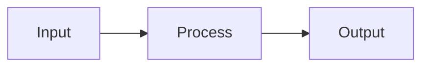

# dsh-plugin-mermaid

个人维护 fork，上游为 [lj970926/dsh-plugin-mermaid](https://github.com/lj970926/dsh-plugin-mermaid)。当前 fork 适配 DSH `0.2.2` 起的 `0.2.x`，基于 Mermaid 渲染器提供简洁的图表样式和放大查看器，保留 MIT 许可。

[](./LICENSE)
[](https://github.com/topics/dsh-plugin)
[](https://github.com/deepseek-ai/deepseek-harness)

A [DeepSeek Harness](https://github.com/deepseek-ai/deepseek-harness) (DSH) web
client plugin that renders ` ```mermaid ` code blocks in chat messages, with a
**chart ↔ source** toggle and live theme switching.

- Mermaid `12.2.0` vendored in the repository and loaded on demand from DSH.
  No runtime CDN or external package download; the complete renderer is a
  separate local chunk, so ordinary messages do not load its 3.4 MiB payload.
- Follows DSH dark/light theme automatically.
- Neutral light/dark palettes, rounded flowchart nodes, and the actual DSH UI
  font instead of Mermaid's default theme.
- Responsive inline SVGs fit the chat width by default. Tall diagrams expand
  fully in the conversation instead of being clipped into a short scroll area;
  a natural-size toggle is available for reading dense diagrams.
- Accessible expanded viewer with zoom, fit-to-window, mouse panning,
  Ctrl/Cmd-wheel zoom, and Escape to close.
- 500 ms debounce so streaming tokens don't thrash the renderer.
- Serialized rendering and stale-result checks keep streaming updates and
  theme changes from publishing outdated diagrams.
- Native DSH code-block banner integration: buttons sit right next to the
  built-in **Copy** button; source view keeps Shiki highlight and copy.
- Zero build step — the browser entry is hand-written factory-form CJS exactly
  as DSH's `client-modules` service expects.

## Install

### From GitHub (recommended)

This package ships prebuilt `lib/` files and declares `dsh.bundle`, so it can
be installed directly into the DSH web profile:

```bash
dsh plugin --profile web add github:zh826256645/dsh-plugin-mermaid
```

Then restart `dsh web` and hard-refresh the browser (Cmd+Shift+R).

To pin a revision for reproducibility, append a commit SHA or tag:

```bash
dsh plugin --profile web add github:zh826256645/dsh-plugin-mermaid#<commit-or-tag>
```

> Because the published files are already in `lib/`, this package has no
> `prepare` build step and does not require pnpm `allowBuilds` authorization.
> If you fork the repository and add a build step, follow DSH's [packaging
> docs](https://deepseek-harness.github.io/deepseek-harness/develop/basic/publish)
> and add the package key under `allowBuilds` in the profile's
> `pnpm-workspace.yaml` when prompted.

### From this local checkout

If you are developing the plugin, install the checkout as a linked bundle:

```bash
dsh plugin --profile web add /Users/zhonghao/Projects/dsh-plugin-mermaid
```

本地目录依赖会链接到当前 checkout。修改 `lib/client.js` 后强制刷新浏览器；如果服务仍在缓存旧模块，再重启 `dsh web`。不需要重新打包。

### Legacy copy script

The repository also keeps `install.sh` for copying files directly into an
existing web profile:

```bash
git clone https://github.com/zh826256645/dsh-plugin-mermaid.git
bash dsh-plugin-mermaid/install.sh
```

The script:

1. Copies this folder into `$DSH_HOME/profiles/web/node_modules/dsh-plugin-mermaid/`
   (defaults to `~/.dsh/profiles/web/...`).
2. Appends an `insert` entry to
   `$DSH_HOME/profiles/web/cordis.patch.yml` (idempotent).

Then restart `dsh web` and hard-refresh the browser (Cmd+Shift+R).

### Manual install (no script)

```bash
mkdir -p ~/.dsh/profiles/web/node_modules/dsh-plugin-mermaid
cp -R lib vendor package.json cordis.patch.yml ~/.dsh/profiles/web/node_modules/dsh-plugin-mermaid/
cat >> ~/.dsh/profiles/web/cordis.patch.yml <<'EOF'

- insert:
    - id: dsh-plugin-mermaid
      name: dsh-plugin-mermaid
EOF
```

> Prefer `dsh plugin add`; it records the bundle in the profile manifest and
> keeps it enabled across profile updates. Newer DSH releases require the
> profile's `cordis.patch.yml` to parse as a top-level YAML array; if the file
> has no entries, keep it as `[]`. The legacy install script normalizes this
> for you.

## Usage

Send any message containing a fenced mermaid block, e.g.:

````markdown

````

DSH renders it as a code block; the plugin enhances it with:

- **源码 / 图表** toggle — switch between Mermaid source and rendered SVG.
- **放大** — open the expanded viewer; zoom from 10% to 400%, fit the chart
  to the window, or return to its natural size.
- **原尺寸 / 适应宽度** — toggle inline charts between readable natural size
  with horizontal scrolling and a width-fitted overview.
- **重试** — shown when rendering fails; source remains available.

Inline charts have no fixed height limit, so the conversation's normal page
scrolling reveals the entire diagram. They fit the available width without
upscaling small diagrams; use **原尺寸** when an especially wide chart makes
labels too small.
In the expanded viewer, drag with the mouse to pan, use Ctrl/Cmd + mouse wheel
to zoom around the pointer, or use the toolbar. Touch devices use native
scrolling and the zoom buttons. Escape or **关闭** closes the viewer and
returns keyboard focus to the opening control.

Authored Mermaid `classDef` colors and diagram-specific syntax remain in
effect. Rendering continues to use Mermaid's strict security mode.

Theme changes (Settings → Appearance) re-render all blocks with the matching
Mermaid theme.

## How it works

| File | Role |
|---|---|
| `package.json` | Declares `dsh.client.platform = "web"` and `./client` export. The `./package.json` subpath export is required because DSH resolves plugins via `require.resolve('<pkg>/package.json')`. |
| `lib/index.js` | Host half (ESM, no-op). DSH's Cordis loader needs named `name`/`inject`/`apply` exports; it does nothing on the host because all work is browser-side. |
| `lib/client.js` | Browser half: registers itself with `window.__ModuleLoader__.load({id, factory})`, applies the chart theme and viewer, and observes `.md-code-block` sources for streaming updates. |
| `lib/client.mermaid.js` | The complete prebuilt Mermaid renderer, adapted as a native package-local DSH chunk. Loaded only when a Mermaid block needs rendering. |
| `vendor/mermaid/` | Mermaid license, pinned version, upstream source, integrity and SHA-256, and regeneration instructions. |
| `scripts/vendor-mermaid.mjs` | Regenerates the checked-in chunk from a verified local extraction of the official npm package. Used only for vendor maintenance, not installation or rendering. |
| `test/client.test.js` | Dependency-free Node tests for themes, sizing, detection, error recovery, stale results, and serialized rendering. |
| `test/vendor.test.js` | Validates the local chunk registration, preserved upstream bytes/license, and packaged file inclusion. |
| `test/browser.html` | Real-Mermaid browser fixtures for flowcharts, sequences, states, classes, ER diagrams, wide/tall charts, and authored colors. |
| `install.sh` | Copies the package into the web profile and patches `cordis.patch.yml`. |

The plugin reads explicit language metadata (`data-code-language`, a `language-*` class, or the legacy `.infostring` banner) and supports the shared code-card toolbar. Current DSH toolbars replace unsupported grammar names with localized generic labels. When no language metadata remains, the plugin recognizes a Mermaid diagram declaration at the start of the source, after optional YAML frontmatter and Mermaid comment lines. Explicitly labeled non-Mermaid languages remain code. Streaming declarations are checked again as source text arrives.

## Requirements

- DSH `>= 0.2.2 < 0.3.0` (tested on `0.2.2-alpha.2`).
- DSH's package-local client chunk loader (`require.async`).
- No external network access is required for Mermaid rendering. The browser
  obtains `client.mermaid.js` from the same DSH server as the chat page.

## Development

The browser file is plain JavaScript; no build step. Edit `lib/client.js`, then:

```bash
node --check lib/client.js
npm test
# With the local profile link, hard-refresh DSH; restart dsh web only if
# its module cache still serves the old client. No copy/install step needed.
```

If you are running DSH from a source checkout with `pnpm run dev:web` and
re-enable `client-hmr`, edits to `lib/client.js` hot-reload without restart.

本地维护时优先使用 profile 的本地目录依赖，而不是 `install.sh` 复制文件：

```bash
dsh plugin --profile web add /Users/zhonghao/Projects/dsh-plugin-mermaid
```

同步上游：

```bash
git fetch upstream
git merge upstream/main
```

Browser regression fixtures (no installation required):

```bash
python3 -m http.server 8767 --bind 127.0.0.1
# Open http://127.0.0.1:8767/test/browser.html
```

Check both themes, source/chart switching, inline width-fit/natural-size
switching, full-height tall charts, viewer zoom and panning, Escape/focus
restoration, and a narrow mobile viewport.
The fixtures import the same `lib/client.js` and checked-in Mermaid chunk as
DSH. For an offline regression, disable browser caching and block external
HTTP(S) requests while allowing the local fixture/DSH server.

The bundled renderer is pinned rather than silently following CDN updates.
See [vendor/mermaid/README.md](vendor/mermaid/README.md) for provenance and the
explicit upgrade/regeneration procedure.

## Uninstall

1. Remove the block from `~/.dsh/profiles/web/cordis.patch.yml`.
2. `rm -rf ~/.dsh/profiles/web/node_modules/dsh-plugin-mermaid`.
3. Restart `dsh web`.

## License

MIT © [lj970926](https://github.com/lj970926)
